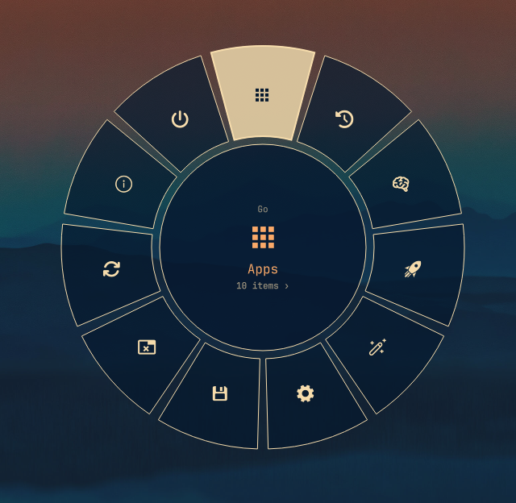

# OmaWheel

Weapon-wheel style radial menu for [Omarchy](https://omarchy.org), built as a
native Quickshell shell plugin — in the spirit of FPS weapon wheels (Far Cry /
Red Dead Redemption) but theme-conscious and auto-populated just like the
Omarchy menu.




## What it is

- **One ring per level (RDR-style drill-in).** The root wheel shows the
  top-level Omarchy menu; clicking a wedge descends into its sub-wheel.
  The hub goes back one level (closes at root).
- **Auto-populates like `omarchy.menu`.** Reads the same sources — stock
  `default/omarchy/omarchy-menu.jsonc` plus
  `~/.config/omarchy/extensions/omarchy-menu.jsonc` — merges them the same
  way, evaluates the same `when:` / `checked:` guards in one batched bash
  process, and serves the same providers (`apps` native via
  `shell.appLibrary`, plus `fonts` / `power-profiles` bash enumerations).
  No separate wheel config to maintain.
- **Theme-conscious.** All colors come from the central `[menu]` section
  (`Color.menu.*`), geometry/typography from `Style.*` tokens, borders via
  `Border.surfaceSpec("menu", …)`. Switching Omarchy themes restyles the
  wheel with no plugin changes.
- **Point + click (v0.1).** Hover highlights a wedge, click activates.
  Arrows + Enter / Space as keyboard fallback; `Esc` backs out / closes.
- **Type-to-filter search.** Typing dims non-matching wedges, snaps hover
  to the best ring match, and shows the global (deep) best match in the hub
  for Enter-to-launch. `Esc` clears first, closes second.
- **Destructive confirm.** Shutdown / reboot / logout open a stock
  confirmation dialog defaulting to Cancel instead of firing on a misclick.
- **Launch feedback.** Fired items flash their label in the hub with a
  `launching…` pulse before the wheel closes.
- **Global Recent.** Every launch from the wheel — apps and menu actions —
  is recorded (max 8, persisted in
  `~/.local/state/omarchy/omawheel-recents.json`) and duplicated into a
  top-level **Recent** wedge next to Apps. Originals keep their normal
  spots; empty Recent hides itself.
- **Custom image icons.** Any `icon` that looks like a path (absolute,
  `~`, `file://`, `image://`) renders as an image instead of a glyph —
  in your `omarchy-menu.jsonc` user entries as well as app icons.
- **Wheel editor.** Summon with `{"edit":true}` to add, rename, re-icon,
  hide, or delete entries in your *user* menu file — stock entries become
  per-key overrides, never touching the defaults.

## Requirements

- Omarchy with its Quickshell shell (`omarchy-shell`)
- Hyprland (summon via shell IPC + keybind)

## Install

```bash
# 1. Clone as a user plugin (folder name must match manifest id)
git clone <repo-url> ~/.config/omarchy/plugins/oma.wheel

# 2. Rescan + enable
omarchy-shell shell rescanPlugins
omarchy plugin enable oma.wheel

# Validate
omarchy plugin validate ~/.config/omarchy/plugins/oma.wheel

# 3. Restart the shell so the new plugin code loads, then summon it
omarchy restart shell
```

Developing locally? Clone anywhere and link it instead:

```bash
ln -s ~/Projects/OmaWheel ~/.config/omarchy/plugins/oma.wheel
```

## Keybind

Pick a free binding (check `omarchy menu keybindings --print` first).
`SUPER + Z` is free on stock Omarchy and a good default for a wheel:

```lua
-- ~/.config/hypr/bindings.lua
o.bind("SUPER + Z", "OmaWheel", "omarchy-shell shell toggle oma.wheel '{\"menu\":\"root\"}'")
```

Deep-link straight into a submenu with any `omarchy.menu` route
(id or alias):

```bash
omarchy-shell shell summon oma.wheel '{"menu":"system"}'
omarchy-shell shell summon oma.wheel '{"menu":"power"}'      # alias → system
omarchy-shell shell summon oma.wheel '{"menu":"style.theme"}'
omarchy-shell shell summon oma.wheel '{"menu":"apps.graphics"}'  # provider submenus resolve once enumerated
omarchy-shell shell hide oma.wheel
omarchy-shell shell call oma.wheel ping x
omarchy-shell shell summon oma.wheel '{"edit":true}'   # wheel editor
```

Custom image icon in your user file
(`~/.config/omarchy/extensions/omarchy-menu.jsonc`):

```jsonc
{
  "trigger.terminal": {
    "icon": "~/.config/omarchy/icons/term.png",
    "label": "Terminal",
    "action": "xdg-terminal-exec"
  }
}
```

Any `icon` starting with `/`, `~`, `file://`, or `image://` renders as
an image; anything else renders as a glyph as before.


## How it works

```
omarchy.menu JSONC ─┬─► defaultMenuFile (FileView, watchChanges)
                    └─► userMenuFile    (FileView, watchChanges)
                              │ parse (WheelModel.js, ported from MenuModel.js)
                              ▼
                    mergeMenuSources → items / itemOrder
                              │ evaluateGuards (single batched bash)
                              ▼
                    visibleChildren(activeMenu) → currentRows → ring
                              │ providersLoaded per submenu
                              ▼
                    apps (appscan.py fallback) / fonts / power-profiles
```

`WheelModel.js` is a verbatim port of the first-party `MenuModel.js`
pure-logic layer (JSONC strip, normalize, merge, `resolveRoute`,
`isVisible`, guards script builder, provider row swapping) so the wheel
can never drift from the stock menu's semantics. Only the presentation
layer (`Menu.qml`) is new: Canvas wedge sectors + rim icons + hub readout,
instead of the stock vertical list.

`appscan.py` enumerates XDG `.desktop` files (user → system → flatpak)
into `<id>\t<Name>\t<GenericName>\t<Icon>\t<Keywords>\t<Categories>`
rows as the last-resort backend; the primary path reads
`DesktopEntries.applications` synchronously (no spawn), launching via
`uwsm-app -- gtk-launch`. Bare icon names resolve exactly like the stock
menu: absolute paths direct, then a bash-scanned name → file index
(verbatim port of the stock `AppLibrary` scan — covers icons Qt's themed
lookup misses), then `Quickshell.iconPath`. Stock-hidden apps stay hidden:
`launcher.hides` plus the `hidden-entries.sh` desktop filter are honored,
so those ids never get rows. Apps
are grouped by XDG main category (`Games`, `Internet`, `Media`,
`Graphics`, `Office`, `Development`, `System`, `Settings`, `Utilities`,
`Other`; empty groups omitted) so the Apps ring holds ~10 wedges and
each category opens its own sub-wheel.

## Host quirks discovered (verified live via `debugApps`)

- **`shell.appLibrary` facade is null.** The shell docs promise menu
  plugins an application-library facade, but `debugApps`
  (`omarchy-shell shell call oma.wheel debugApps x`) reports
  `appLibraryNull: true` on this host — for fresh summoned instances
  and a minimal probe plugin alike. Hence the `appscan.py` fallback.
  The native path is kept first: if the facade ever becomes non-null,
  the wheel uses it (hidden-entry filtering, launch feedback) with no
  code change.
- **`keepLoaded: false` is load-bearing.** With `keepLoaded: true` the
  instance is created during shell startup and never receives the
  `shell` injection (`shellNull: true`); loaded at summon time it does.
  Until the host fixes startup-time injection, the wheel loads per
  summon (slightly slower cold open, always correct).
- **Cold-open route race.** A non-kept instance is born with empty
  items; `open()` can arrive before either JSONC `FileView` reports.
  Routes requested early are stashed in `pendingRoute` and the merge
  waits for *both* sources (`defaultReported && userReported`) before
  resolving — otherwise a half-merge mis-resolves deep links to root.
- **Rescan ≠ reload.** `rescanPlugins` and file-watch hot-reload do not
  reliably replace running plugin code; test code changes with
  `omarchy restart shell`.

## Theming contract

| Token | Use |
|---|---|
| `Color.menu.background / text / border / scrim` | ring fill, labels, ring border, fullscreen dim |
| `Color.menu.selectedBackground / selectedText / selectedBorder` | hovered wedge fill, label, edge |
| `Style.cornerRadius / gapsOut / space() / font.*` | hub rounding, screen padding, radii, type scale |
| `Style.fontFamily` | glyph icons + labels (respects `omarchy font set`) |

No hardcoded palette values in `Menu.qml` — grep should find none.

## Wheel editor

Summon with `omarchy-shell shell summon oma.wheel '{"edit":true}'` (see
`bindings.lua.example` for a keybind). The editor browses the merged menu
and writes to your **user** file only
(`~/.config/omarchy/extensions/omarchy-menu.jsonc`):

- **Add item here** — new submenu or action under the browsed menu.
  Ids derive from the label (`parent.slug`) and stay unique.
- **Edit** — rename / re-icon anything. Stock entries become minimal
  per-key overrides (only the keys you change); custom entries edit freely.
- **Delete** — removes custom entries with their whole subtree.
- **Hide / Unhide** — stock entries hide via a `when: "false"` override
  (other custom keys preserved); unhiding drops just the override.
- **Clear** — the generated `Recent` row offers Clear to empty the global
  recents (the wedge hides itself until the next launch).
- Rows are badged `stock` / `custom` / `hidden` / `auto` (provider rows
  like app categories can't be edited). Saves apply live through the
  existing file watcher.
- **Saves are surgical.** The editor patches single entry spans in the
  file text instead of rewriting it, so hand-written comments, formatting,
  and other tools' marker blocks (e.g. shibumi's routing comments) in
  your user file survive untouched. Stock overrides also pass unmanaged
  keys (`provider`, `target`, `aliases`, `iconFont`, guards…) through, so
  renaming an entry can't silently kill its provider or alias routes.

## Roadmap

- [ ] v0.1 polish: empty-state art, long-label wrapping, >12-wedge density
- [ ] Hold-to-summon / flick-select (Far Cry slow-mo feel) — skipped by request
- [ ] Dual-ring variant (inner categories + outer actions)
- [ ] preview.png: capture a real screenshot (README already embeds it)

## License

MIT
